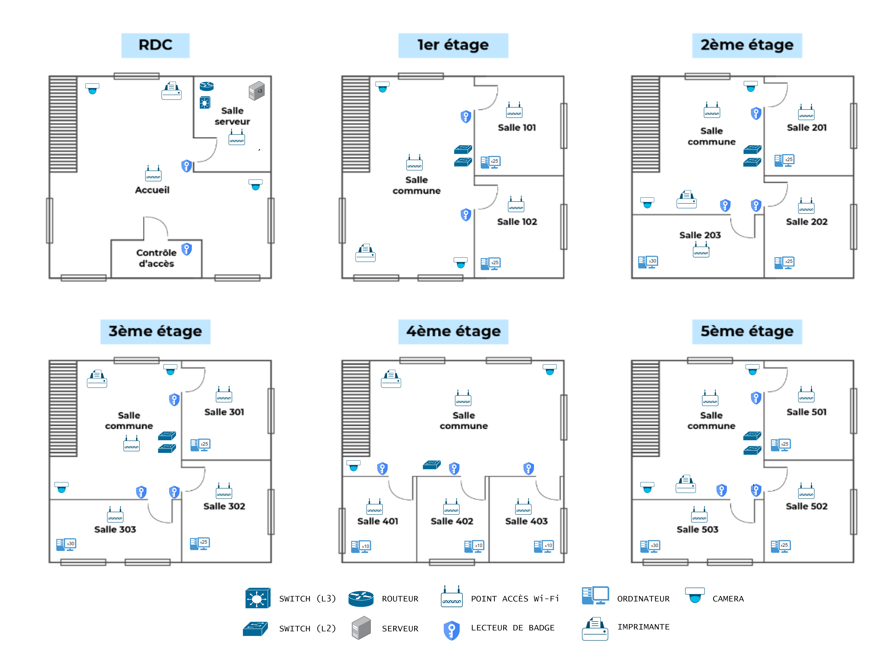
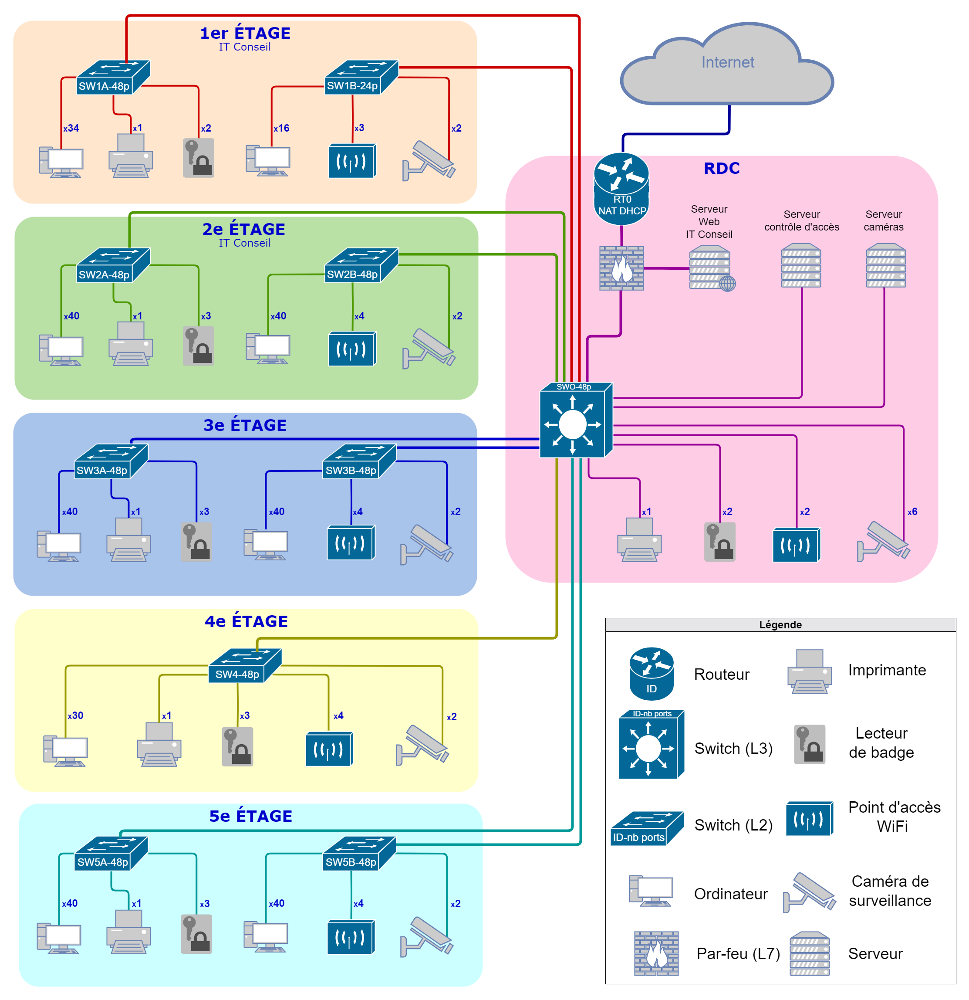
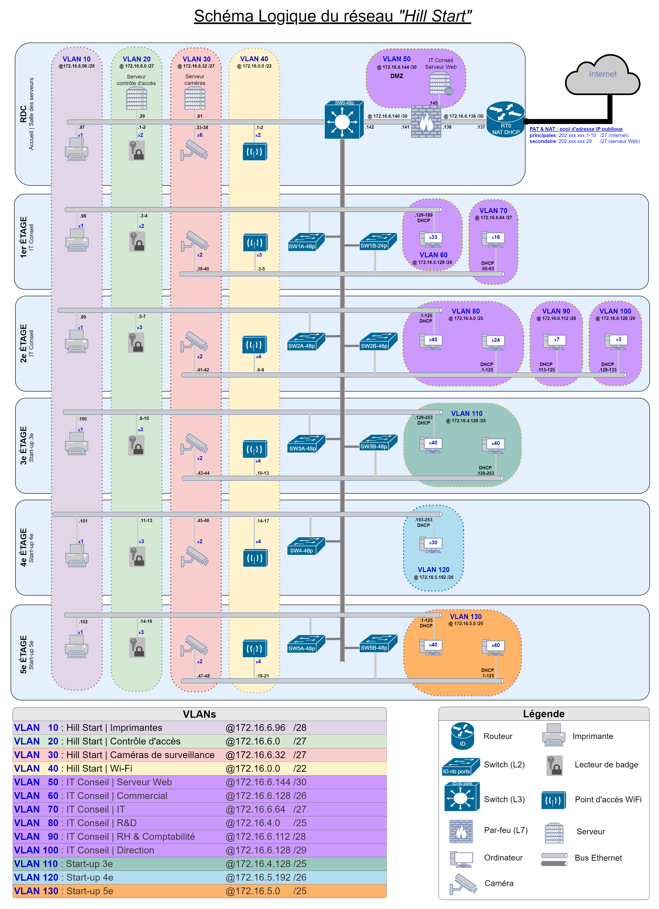

# Projet 3 : Mettre en place et documenter le réseau local d'une startup

[Sujet du projet](https://openclassrooms.com/fr/paths/734/projects/1381/assignment) · Entreprise fictive : **Hill Start**

## Mission

Concevoir le réseau local du nouveau bâtiment de Hill Start (rez-de-chaussée et 5 étages) :

- **Schéma physique** : emplacement des équipements dans le bâtiment, et capacité de chaque switch selon le cahier des charges.
- **Schéma logique** : VLAN (noms, adresses réseau, masques) et règles de communication entre les VLAN.
- **Plan d'adressage** : adresses IP de chaque VLAN (DHCP ou statiques), masques et adresses de broadcast.

## Réalisation

1. J'ai étudié le cahier des charges et les plans du bâtiment.
2. J'ai dessiné le schéma physique : l'emplacement de chaque équipement par local et le dimensionnement des switches.
3. J'ai défini les VLAN et leurs plages d'adresses, avec des masques adaptés au nombre de postes.
4. J'ai rédigé le plan d'adressage (DHCP et IP statiques) et une matrice des flux autorisés entre les VLAN.

### Répartition des équipements par étage

### Schéma physique

### Schéma logique

## Compétences

- Concevoir la cartographie d'un réseau avec [draw.io](https://app.diagrams.net/)
- Construire un réseau TCP/IP : VLAN, sous-réseaux, plan d'adressage
- Rédiger une documentation technique

## Ressources

- [Maîtrisez vos applications et réseaux TCP/IP](https://openclassrooms.com/fr/courses/2340511-maitrisez-vos-applications-et-reseaux-tcp-ip)
- [Concevez votre réseau TCP/IP](https://openclassrooms.com/fr/courses/6944606-concevez-votre-reseau-tcp-ip)
- [Path MTU discovery](https://fr.wikipedia.org/wiki/Path_MTU_discovery)
- [Guide de l'ANSSI : cartographie du système d'information](https://cyber.gouv.fr/publications/cartographie-du-systeme-dinformation)
